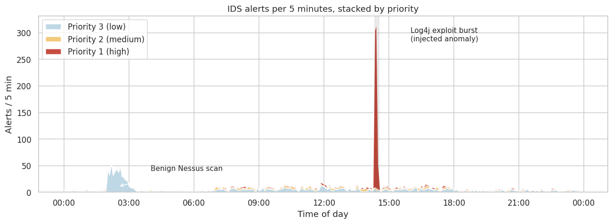
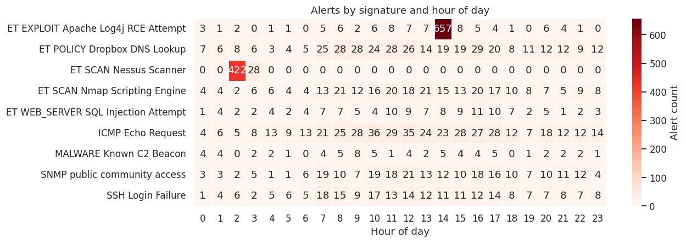
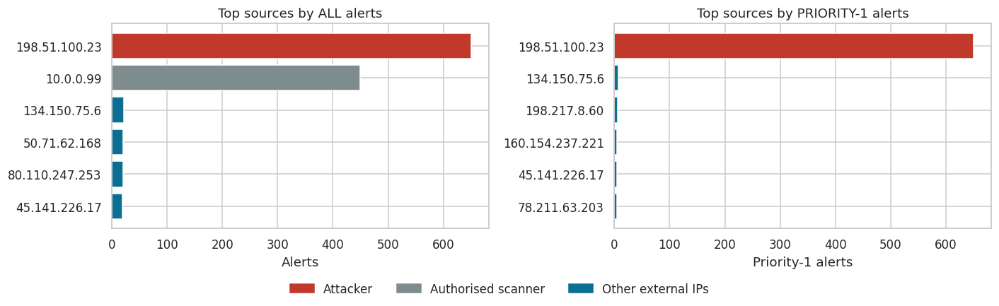
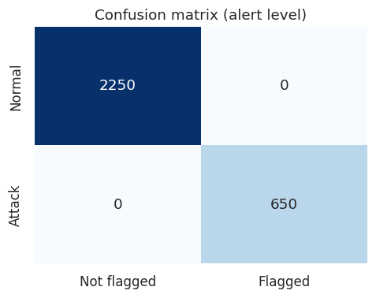
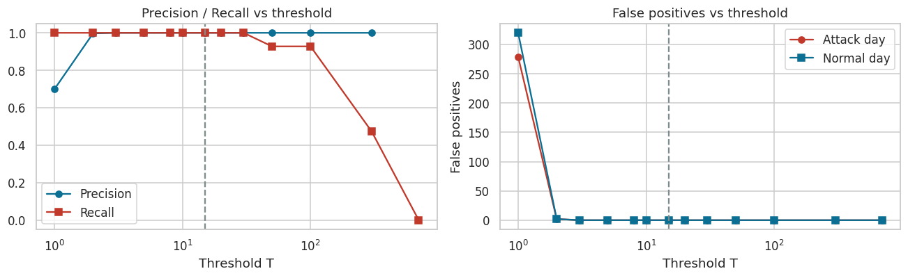

# Visualization of Intrusion Detection (IDS) Alerts

Detecting an exploit burst in simulated Snort/Suricata alerts using Python visualization and a simple rule-based detector.

---

## Overview

An IDS sensor produces thousands of alerts per day, and most of them are low-priority noise. This project shows how visualization helps an analyst find the few alerts that matter, then turns that insight into one automatic detection rule and evaluates it.

## Dataset

The data is **simulated**, with the fields a Snort/Suricata log provides, and it is fully reproducible (fixed random seeds).

| Component | Alerts | Description |
|---|---|---|
| Normal background | 1,800 | ~150 external IPs, 8 signatures, busier during working hours |
| Benign noisy source | 450 | Authorised internal Nessus scanner (`10.0.0.99`), low priority |
| **Injected anomaly** | 650 | `198.51.100.23` sends Log4j RCE exploit attempts (priority 1) to the web servers, 14:20–14:31 |
| **Total** | **2,900** | |

**Columns:** `timestamp`, `src_ip`, `dst_ip`, `dst_port`, `signature`, `category`, `priority`, and a ground-truth label `is_attack` (used only for evaluation, never by the rule).

The scanner is a deliberate trap: it produces many alerts but is harmless, so a rule based on raw volume fails.

## Visualizations

**1. Alerts over time, stacked by priority.** A large priority-1 spike appears at 14:20.



**2. Heatmap of signature × hour.** It names the attack type responsible.



**3. Top sources: volume vs. severity.** By volume the scanner looks as threatening as the attacker. By severity only the attacker stands out.



## Detection rule

> Raise an alert when a single source IP generates **at least 15 priority-1 alerts within a 5-minute window**.

On normal data the maximum is 2 priority-1 alerts per (IP, window), while the attacker produces 295, 308 and 47 in three consecutive windows.

## Results

| Scenario | TP | FP | FN | TN | Precision | Recall | F1 |
|---|---|---|---|---|---|---|---|
| Attack day | 650 | 0 | 0 | 2,250 | 1.00 | 1.00 | 1.00 |
| 5 normal-only days | – | 0 | – | – | – | – | no false alarms |
| Baseline: volume-only rule | 650 | 422 | 0 | 1,828 | 0.61 | 1.00 | 0.76 |

- The rule is perfect for any threshold from 3 to 30.
- Thresholds of 1–2 cause false positives, and thresholds of 50 or more miss the short last attack window.




## Key findings

1. The anomaly is located at **14:20–14:31**, from `198.51.100.23`, with signature *Log4j RCE*.
2. Raw alert volume is misleading. Combining **severity and rate** separates an attack from a noisy but benign scanner.
3. The rule detects every attack alert and raises no false alarms on normal data.

## Repository structure

```
.
├── Lab02_IDS_Alerts_Visualization.ipynb   # Full analysis (outputs included)
├── Lab02_Report.md                        # Written report
├── figures/                               # Generated plots
├── requirements.txt
└── README.md
```

## How to run

```bash
git clone https://github.com/YOUR_USERNAME/YOUR_REPO.git
cd YOUR_REPO
pip install -r requirements.txt
jupyter notebook Lab02_IDS_Alerts_Visualization.ipynb
```

Then choose **Run All**. No external data is needed.

## Limitations and future work

- The data is simulated, so the clean separation is optimistic; real traffic is noisier.
- A fixed 5-minute window misses low-and-slow attacks, and per-IP counting misses distributed attacks.
- Next steps: per-host adaptive baselines (Z-score, Isolation Forest) and validation on a real dataset such as CIC-IDS2017 or UNSW-NB15.

## Tools

Python · Pandas · NumPy · Matplotlib · Seaborn · Jupyter
